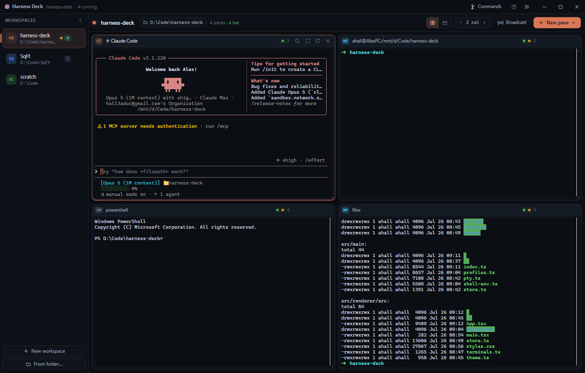

# Harness Deck

A desktop workspace for running coding-agent CLIs side by side.

Each **workspace** is a named set of terminals — one per project, experiment or
comparison. Open Claude Code in one pane, Codex in the next, a shell and a log
tail below them, then switch to another workspace while everything keeps
running in the background.

Built with Electron, React and xterm.js; real PTYs via `node-pty`.



## What it does

**Workspaces** — Create as many as you like. Each has its own folder, accent
colour, layout and set of panes. `Ctrl+1…9` jumps between them; processes in
the ones you're not looking at keep running.

**Harness detection** — On startup the app scans your *login shell's* `PATH`
(not the stripped-down environment a GUI app normally inherits) for `claude`,
`codex`, `copilot`, `gemini`, `opencode`, `aider` and `cursor-agent`. On
Windows it also looks inside WSL and offers those as separate profiles, so
agents installed in your Linux home are one click away. Anything it can't find
is still listed with the command to install it.

**Layouts** — An even grid (1–4 columns) or tabs, per workspace. Any pane can
be zoomed to full size with `Ctrl+Shift+Z` and restored again; the process is
resized properly, so TUIs reflow instead of corrupting.

**Broadcast** — Type one prompt and send it to every agent pane in the
workspace at once (`Ctrl+Shift+B`). Useful for handing the same task to two
models and comparing. `Ctrl+Shift+E` takes what is selected in the focused
pane, fences it, and drops it in the box for you to describe.

**Dictation** — `Ctrl+Shift+M` records you and types the transcript into the
focused agent's prompt line, or into the broadcast box when that has focus. It
stops on its own when you stop talking. Transcription runs through OpenRouter,
OpenAI, Groq or a local Whisper server. See [Dictation](#dictation).

**Status at a glance** — Per-pane running/exited dots, an activity dot when a
background pane produces output, and the process title the agent reports (so a
pane says what Claude is doing, not just "claude").

**Attention routing** — A running pane that stops producing output has hit a
prompt, an approval gate, or finished, so it turns amber and the workspace it
lives in shows a waiting count. `Ctrl+Shift+J` jumps to the next one, the dock
badge counts them, and a background window notifies once as each goes quiet.
How long the silence has to last, and whether it notifies or badges at all, are
in Settings.

**The waiting queue** — `Ctrl+Shift+U` lists every waiting pane across every
workspace, oldest first, each with the last three lines it printed: for an agent
at an approval gate, that tail is the question. Three reversible verbs on each
row — `A` acknowledge (seen it, until it stops again), `S` snooze (until it next
goes quiet, then for an hour), `M` mute (this pane never counts). A snoozed pane
that rings the terminal bell comes back at once.

**Survives restarts** — Workspaces, panes, folders and layout are saved to
`workspaces.json` in the app's user-data folder. Reloading the window
re-attaches to the running processes and repaints the last ~512 KB of output.

**In-place updates** — `npm run release` builds a new installer and the running
app offers it in a toast; one click restarts into the new version. See
[Releasing and updating](#releasing-and-updating).

## Requirements

- Node.js 20+ and npm (for development)
- Windows, macOS or Linux
- At least one agent CLI on your `PATH` — or WSL with one installed

## Getting started

```bash
npm install
npm run dev      # live-reloading development build
```

Other scripts:

```bash
npm run build     # bundle main, preload and renderer into out/
npm start         # run the bundled app
npm run typecheck # tsc over both projects
npm test          # unit tests (vitest)
npm run smoke     # build, then boot the app and assert it works
npm run package   # build installers into release/ (electron-builder)
npm run release   # bump the version, package, and notify a running copy
```

### Linux

Electron needs a handful of system libraries that a minimal distro (including
a fresh WSL image) doesn't ship:

```bash
sudo apt install -y libnss3 libnspr4 libatk1.0-0 libatk-bridge2.0-0 libcups2 \
  libdrm2 libgbm1 libgtk-3-0 libasound2 libxkbcommon0 libxcomposite1 \
  libxdamage1 libxfixes3 libxrandr2
```

### Windows + WSL

Run the app on Windows and it will find agents in both places. WSL panes are
launched as `wsl.exe -e bash -lic '…'` and the pane's folder is handed over as
a translated Unix path (`D:\Code\app` becomes `/mnt/d/Code/app`) using
`WSLENV`, so the agent starts in the right directory.

### macOS

The window keeps its traffic lights and gains a small menu bar — macOS routes
`Cmd+Q`, `Cmd+W` and the text-field clipboard through it, so an app without one
can't quit or paste. Closing the window leaves the agents running and the app
in the dock; reopening re-attaches every pane. Homebrew's `bin` directories are
added to `PATH` on top of the login-shell environment, since a Finder-launched
app never inherits them and that is where most agent CLIs live.

Packaging must happen **on a Mac**: `@lydell/node-pty`'s prebuilt binaries are
per-platform optional dependencies, so an `npm install` run on Windows or Linux
never fetches the Darwin one and the packaged app would have no pty.

```bash
npm run package   # dmg + zip for arm64 and x64 into release/
```

Unsigned builds are fine locally — set `CSC_IDENTITY_AUTO_DISCOVERY=false` — but
Gatekeeper quarantines a DMG that has been downloaded, so a build meant for
anyone else needs an Apple Developer ID and notarisation. The hardened-runtime
entitlements it needs are already in `build/entitlements.mac.plist`. Drop a
1024px `build/icon.icns` in to replace the stock Electron icon.

## Dictation

`Ctrl+Shift+M` (or the **Dictate** button) opens the microphone, and the
transcript is typed into whatever prompt had focus — the focused pane's agent,
or the broadcast box if you were in it. A pill at the bottom of the window shows
the input level while it listens; `Esc` throws the recording away, and the
shortcut again stops it early. With **stop when I stop talking** on (the
default) it ends after about 1.7 seconds of silence, measured against the room's
own noise rather than a fixed level.

The text is typed but *not* sent, so you can edit it before pressing Enter —
turn on **press Enter after dictating** if you would rather it go straight out.
Newlines are collapsed to spaces so a transcript can never submit half a prompt
to a TUI. If the pane closed while you were talking, the transcript goes to the
clipboard instead of nowhere.

A recording that never rose above the room for at least 150 ms is dropped
without being sent anywhere. That saves a pointless request, but the real reason
is that a chat model asked to transcribe silence does not answer "silence" — it
invents a plausible coding prompt, and that text would land in your agent.

### Setting it up

Transcription is done by a service you choose in **Settings › Voice input**:

| Service | Default model | Notes |
| --- | --- | --- |
| OpenRouter *(default)* | `google/gemini-2.5-flash-lite` | Spends OpenRouter credits, ~$0.0001 a prompt |
| OpenAI | `gpt-4o-mini-transcribe` | Also `gpt-4o-transcribe`, `whisper-1` |
| Groq | `whisper-large-v3-turbo` | Usually the fastest turnaround |
| Custom | `whisper-1` | Any OpenAI-compatible `/audio/transcriptions` |

Pick **Custom** and point the endpoint at something like
`http://127.0.0.1:8000/v1` to use a local Whisper server, which needs no key at
all.

OpenRouter is the odd one out: it has no transcription endpoint, so audio goes
to a multimodal chat model as a base64 message part, and those models want WAV
rather than the Opus everything else takes. The recording is decoded and
re-rendered to 16 kHz mono in the renderer before it is sent, and the model is
instructed to return the words and nothing else — the reply is stripped of the
quotes and "Transcription:" labels a chat model likes to add. Any OpenRouter
model that accepts audio input can be named in the model field.

Keys can be pasted into Settings — they are encrypted with the OS keychain
(`safeStorage`) and stored per service in `voice-keys.json` beside the layout
file, never in `workspaces.json`. If you already export `OPENROUTER_API_KEY`,
`OPENAI_API_KEY`, `GROQ_API_KEY` or `HD_VOICE_API_KEY` in the environment the app
was started from, it picks that up and nothing needs saving. Audio is posted
straight to the service and is not written to disk; the **vocabulary hint** field
is worth filling in with the project nouns your model keeps mangling.

Windows only asks for the microphone once, at the OS level: if capture is
blocked, the pill offers a shortcut to the privacy page. macOS prompts on first
use.

## Keyboard

Terminals get every plain key combination, so the app keeps to `Ctrl+Shift`
and `Alt`. On macOS use `Cmd` in place of `Ctrl` — plus `Cmd+C` / `Cmd+V` on a
pane, and `Cmd+Alt+I` for developer tools.

| Keys | Action |
| --- | --- |
| `Ctrl+1` … `Ctrl+9` | Switch workspace |
| `Ctrl+Shift+N` | New workspace |
| `Ctrl+Page Up/Down` | Previous / next workspace |
| `Alt+Shift+1` … `Alt+Shift+9` | Run the workspace action at that position |
| `Ctrl+Shift+T` | New pane (harness picker) |
| `Ctrl+Shift+W` | Close focused pane |
| `Ctrl+Shift+R` | Restart the process in the focused pane |
| `Ctrl+Shift+Z` | Zoom / restore the focused pane |
| `Ctrl+Shift+J` | Jump to the next pane waiting for you |
| `Ctrl+Shift+U` | The waiting queue (`A` acknowledge, `S` snooze, `M` mute) |
| `Alt+1` … `Alt+9` | Focus pane by position |
| `Ctrl+Tab` / `Ctrl+Shift+Tab` | Next / previous pane |
| `Ctrl+Shift+←/→` | Move the focused pane in the layout |
| `Ctrl+Shift+C` / `Ctrl+Shift+V` | Copy / paste |
| `Ctrl+Shift+F` | Find in pane |
| `Ctrl+Shift+K` | Clear pane |
| `Ctrl+=` / `Ctrl+-` / `Ctrl+0` | Font size |
| `Ctrl+Shift+P` | Command palette |
| `Ctrl+Shift+M` | Dictate into the focused prompt (`Esc` discards) |
| `Ctrl+Shift+B` | Broadcast bar |
| `Ctrl+Shift+E` | Send the focused pane's selection to the broadcast box |
| `Ctrl+Shift+,` | Settings |
| `Ctrl+Shift+/` | Shortcut help |
| `F12` | DevTools |

## How it fits together

```
src/
  main/          Electron main process
    index.ts       window, IPC, smoke-test flags
    pty.ts         PTY sessions: spawn, batched output, replay buffer, resize
    profiles.ts    harness detection (PATH scan + WSL probe)
    shell-env.ts   login-shell environment resolution
    store.ts       atomic JSON persistence
    updater.ts     watches the release channel, runs the installer
    voice.ts       transcription requests + API key storage
    smoke.ts       --smoke: boot the app and assert it works
    pty.test.ts    session lifecycle, against a stub pty
  preload/       contextBridge API (the renderer never touches Node)
  renderer/      React UI
    store.ts       zustand state + debounced persistence
    terminals.ts   registry of live xterm instances
    voice.ts       microphone capture, level metering, transcript delivery
    components/    title bar, sidebar, toolbar, panes, palette, dialogs
  shared/        types shared across the process boundary
scripts/
  release.mjs    cuts a release and publishes its manifest
  make-icons.mjs rasterises build/icon.svg into .icns/.ico/.png
build/
  icon.svg       the app icon, and the only file to edit
```

Processes live in the main process and are addressed by pane id, so a window
reload — or React remounting a pane — never kills a running agent.

A visual version of this map — process topology, the PTY pipeline, persistence,
the voice path, and the full tech stack — is in
[`docs/architecture.html`](docs/architecture.html); open it in a browser.

### The app icon

`build/icon.svg` is the master. After editing it, run:

```bash
npm run icons
```

That regenerates `icon.png` (1024px, also what Linux ships), `icon.icns` and
`icon.ico`, which electron-builder picks up by name — no configuration needed.
Electron itself does the rasterising, so there's no ImageMagick or librsvg to
install. A packaged app gets its icon from the bundle; a `npm run dev` run
loads `build/icon.png` directly so the dock looks right while developing.

## Testing

Two layers, both run in CI on every push and pull request.

```bash
npm test          # unit tests, plain node, ~100ms
npm run smoke     # build, boot the app for real, assert, exit 0/1
```

**Unit tests** (`src/main/*.test.ts`, vitest) cover the pane session lifecycle.
`PtyManager` takes its `spawn` as a constructor argument, so the tests drive a
stub pty and can fire `onData` and `onExit` at exactly the moment that matters —
which is the only way to pin down a restart race deterministically. They run in
plain node, so nothing under test may import `electron`.

**The smoke test** (`--smoke`) is the one that says whether the app actually
runs. It boots the real thing and checks that the renderer mounts past the
harness-detection screen, the window is visible, the chrome renders, a pane
spawns a process and gets its output back, a restarted pane survives the old
process dying, and a missing binary is reported rather than thrown. It prints a
JSON report and sets the exit code; `--smoke-json=<file>` also writes it out.

A smoke run gets its own user-data directory under the temp folder, so it can
neither read nor damage a real session's layout, and its single-instance lock is
separate — it can run while the app is open.

That last one matters more than it looks: a build with no working `node-pty`
packages perfectly, installs perfectly, and fails on the first pane. Typecheck
and a successful `electron-builder` run cannot see it. The smoke test can,
because it starts a real process through a real pty.

The smoke test needs a window server. On the self-hosted Mac that means the
runner has to be a LaunchAgent in a logged-in session rather than a daemon; if
that isn't possible, restrict the step to Windows in `build.yml` — the unit
tests still run on both.

## Releasing and updating

**Settings → Updates** picks where updates come from. **Local manifest** is the
default: a release channel on this machine, no server, nothing to host and no
token to store. **GitHub releases** follows what CI publishes, for a copy that
was installed from there. **Off** stops the checking entirely. Nothing in the
app reaches the network until the channel is changed by hand, so a dev run and
the smoke test never do.

### The local manifest

```bash
npm run release            # 0.1.0 → 0.1.1, package, publish the manifest
npm run release minor      # or major, or an explicit 1.2.3
npm run release -- --notes "Adds pane search"
npm run release -- --no-build   # reuse the installer already in release/
npm run release -- --dry-run    # show the manifest, change nothing
```

The script bumps `package.json`, runs `npm run package`, then writes a manifest
to `%APPDATA%\Harness Deck\update.json` naming the new version and the installer
that goes with it. Notes default to the last commit subject. If the build fails
the version bump is rolled back.

A running Harness Deck watches that file (`fs.watch`, plus a 15-minute poll as a
backstop) and raises a toast bottom-right within about a second: **Restart &
install** hands the release to its NSIS installer with `/S --force-run`, which
replaces the app in place and reopens it. Dismissing the toast leaves an
**Update** pill in the title bar; Settings → Updates has a manual check and the
channel path, and the command palette carries both actions.

Panes are killed by the restart, so an install with live processes asks first —
the same prompt as closing the window, and it obeys the same setting.

A release whose installer is missing or still being written is reported as an
error rather than offered, and the installer's sha512 is verified before it is
launched. Nothing prunes `release/`, so each release leaves its own installer
and zip behind (~240 MB a time) — clear out old versions when it gets heavy.

The build has to run with the Windows toolchain (see the environment notes in
the parent `CLAUDE.md`); on WSL the script locates the Windows npm itself, or
set `WIN_NPM`. `HD_UPDATE_MANIFEST` points the app at a different manifest, and
`HD_USER_DATA` does the same for the script.

### The GitHub channel

On **GitHub releases** the same 15-minute poll fetches the `latest*.yml` that
electron-builder writes beside the installers — `latest.yml` on Windows,
`latest-mac.yml` on macOS — from the rolling
[`latest-main`](https://github.com/pr0xiez/harness-deck/releases/tag/latest-main)
prerelease, which is where a copy installed from CI came from. Tagged releases
are drafts until someone publishes them by hand, so they are not what an
installed copy can see.

Everything after that is the local path again: the version is compared the same
way, the toast is the same toast. The difference is that the installer is not
on this machine yet, so **Restart & install** fetches it into a temp directory
first and only then runs the sha512 check that has always guarded the launch. A
download that arrives corrupt fails that check, is deleted, and is never
started. It is written as `.part` and renamed on completion, so a fetch cut off
halfway is never mistaken for an installer.

The repository to poll comes from `repository` in `package.json` — the same
field electron-builder falls back to — so a fork changes it in one place.
Nothing here holds a credential: release assets are fetched by tag over plain
HTTPS, which means a private repository has no working GitHub channel.
`HD_UPDATE_FEED` overrides the URL outright.

A check that fails — offline, a 404, an unparseable feed — is reported in the
toast and in Settings and leaves the poll running; the next tick tries again. A
slow feed cannot pile up, because a check already in flight turns the next one
away.

### Building both platforms in CI

`npm run release` covers the local Windows loop. `.github/workflows/build.yml`
is the other half: it builds installers for **both** platforms. Each platform's
installer can only be built on that platform — `node-pty` ships a prebuilt
binary per platform, and npm only ever fetches the host's, so a cross-built app
has no working pty, and NSIS needs Wine off Windows. There is no way around the
matrix.

Where each half runs differs:

- **macOS** — a **self-hosted** Mac, which is free and the only machine that
  could ever sign and notarise. Register it as a runner on the repository;
  GitHub labels every self-hosted runner with its OS automatically, and the
  matrix matches `[self-hosted, macOS]` to route the job there. If the Mac is
  offline the job queues rather than fails.
- **Windows** — the GitHub-hosted `windows-latest` image. This one is billed:
  the repo is private and Windows minutes count double against the included
  allowance. Point it at a `[self-hosted, Windows]` pair instead if a Windows
  box ever gets registered.

Because the Mac is Apple Silicon, npm never fetches the Intel `node-pty`
prebuild that the x64 dmg needs, so the workflow installs it by hand. That needs
`--force` as well as `--os`/`--cpu`: the platform flags only steer optional
dependency resolution, and a package named explicitly is still checked against
the real host.

#### Where the installers end up

Every build of `main` refreshes
**[`latest-main`](https://github.com/pr0xiez/harness-deck/releases/tag/latest-main)**, a prerelease
holding the newest installer for each platform. Merge, wait for the build,
download from there — nothing to tag and nothing to bump. It is a rolling
channel, so two builds can share a version and differ; the notes name the commit
each one came from.

Pushing a **`v*` tag** cuts a proper release instead, as a **draft**, so it stays
invisible until published by hand. The tag has to match the version in
`package.json`, which the workflow checks before building, because the release is
named from `package.json` and not the tag. Nothing bumps that version
automatically — `npm run release` does it locally, and doesn't commit or tag
either, so cutting a release is:

```bash
npm run release patch                       # bumps package.json, builds locally
git commit -am "release 0.1.1" && git push
git tag v0.1.1 && git push origin v0.1.1    # this is what publishes
```

Both jobs publish into the same release at the same moment, which
electron-builder's own publisher can't cope with, so `scripts/publish-release.mjs`
does it instead — every write tolerates the other job getting there first. It
talks to the REST API rather than shelling out to `gh`, because the self-hosted
Mac isn't guaranteed to have the CLI. That the two platforms never fight over an
asset is down to the `win`/`mac` in the installer names: both build an x64 zip,
and under the old `${arch}`-only naming one would have silently replaced the
other.

Taking publishing away from electron-builder does **not** take the `latest*.yml`
update metadata with it, which is what the in-app GitHub channel reads: since
electron-builder 26 that file is written from the `publish` block in
`electron-builder.yml` whatever `--publish` says, and `--publish never` only
stops the upload. `scripts/publish-release.mjs` uploads it alongside the
installers, and a workflow step fails the build if it ever stops appearing —
turning `--publish always` back on to get it would buy nothing and put the race
back. Reproduce it with `npx electron-builder --mac zip --arm64 --publish never`
and look in `release/`.

The installers are uploaded with their spaces turned into dashes
(`Harness-Deck-0.1.0-win-x64.exe`). That is not cosmetic: `latest*.yml` names
the installer in electron-builder's own "safe" form, which is the dashed one,
and the updater resolves that name against the release. GitHub would otherwise
rewrite the space to a period and the update would 404.

Pull requests run the same build on both platforms and keep nothing — a PR proves
the installers can be built, then discards them. The gate before packaging is
`npm run typecheck`, `npm test` and the smoke test described under
[Testing](#testing); the smoke report is kept as an artifact for a week.

This is also the second update channel: point **Settings → Updates** at GitHub
releases and the toast follows `latest-main` — see
[The GitHub channel](#the-github-channel) above.

The mac runner builds unsigned (`CSC_IDENTITY_AUTO_DISCOVERY: false`) so it
can't pick up a stray keychain identity. Add `CSC_LINK` and `CSC_KEY_PASSWORD`
secrets and drop that line to sign for real.

## Debugging aids

```bash
# what the app can actually find, as JSON
npx electron . --dump-profiles

# boot the app, assert it works, print a JSON report, exit 0 or 1
npx electron . --smoke

# render the window to a PNG (optionally after pressing chords, in order)
npx electron . --capture=shot.png --capture-delay=8000 \
  --capture-keys=ctrl+shift+p --capture-quit

# record from the mic and transcribe it, as JSON: device, bytes, peak level
npx electron . --voice-check=3000

# ...against a local endpoint instead of the configured one
npx electron . --voice-check=3000 --voice-endpoint=http://127.0.0.1:8787/v1 \
  --voice-model=whisper-1
```

If an agent you have installed doesn't appear, run `--dump-profiles`: the
`detail` field shows the path it resolved or the reason it failed.

`--voice-check` is the quickest way to tell a microphone problem from a
transcription one: it reports the device it opened, how many bytes it captured,
the levels it heard, whether the silence gate would have let it through, and
what the service answered. A `peakLevel` near the `noiseFloor` means the OS
handed over a silent stream — wrong input device, or muted. Note that the check
sends the audio even when the gate says it would skip, so a hallucinated
transcript there is expected rather than alarming.

To exercise dictation with known speech and no microphone, feed Chromium a file
(16-bit PCM, 16 kHz or 48 kHz) in place of the input device:

```bash
npx electron . --voice-check=5000 --use-fake-device-for-media-stream \
  --use-file-for-fake-audio-capture=C:/tmp/speech.wav
```

Two copies of the app share one user-data folder, so a second instance will
overwrite the first one's layout. Pass `--user-data-dir=<path>` to run a
throwaway profile when testing.

Set `HD_DEFAULT_CWD` to choose the folder new workspaces start in (defaults to
your home directory; changeable in Settings too).

## Licence

MIT
